# UniSpace: campus room and lab booking, secured and tested


**Turned a group course app with open admin endpoints and plain-text passwords into one with enforced roles, an audit trail and 94 tests.**

| | |
|---|---|
| **Problem** | Room bookings run on messages and spreadsheets and slots get double-booked. The first version of the app also let anyone act as admin. |
| **Solution** | Server-enforced roles, hashed passwords and signed tokens, a multi-step approval workflow, booking rules enforced by the database, and a redesigned interface. |
| **Result** | **94 automated tests; at most one approved booking per slot, guaranteed by MySQL.** |
| **My role** | Group project of three. I worked from the Flask backend to the frontend; all work after the original submission is mine. |

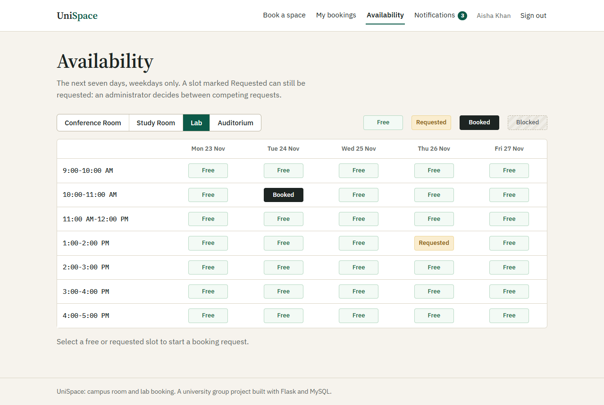

## The problem

Room and lab bookings on a campus tend to run on messages and spreadsheets. Two people ask for the same slot, nobody knows who got it, and when a room is pulled for maintenance the people affected find out late or not at all.

UniSpace turns that into a small, explicit process. A student **requests** a slot. An administrator **reviews** it and **decides**. Everyone sees where a request stands, why it was rejected, and who did what. Rules the business cares about, such as one approved booking per slot, are enforced by the server and the database, not left to good behaviour.

## What it does

| For students | For administrators |
|---|---|
| Create an account and sign in | Review queue filtered by status (new, in review, approved, closed) |
| See a seven-day availability grid per resource | Take a request into review, approve it, reject it or cancel it, with a reason where one is required |
| Request a slot (weekdays, up to seven days ahead) | Approving a request automatically declines the other open requests for that slot |
| Follow each booking and open its full history | Block a slot for maintenance: open requests are rejected, an approved booking is cancelled, students are told why |
| Cancel their own bookings | See a status summary at a glance |
| In-app notifications for every decision | |

### Screens

| Request a booking | My bookings, with one booking's history open |
|---|---|
| 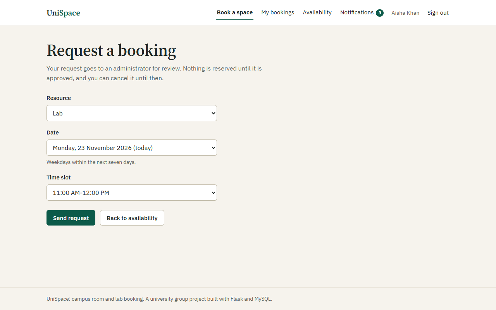 | 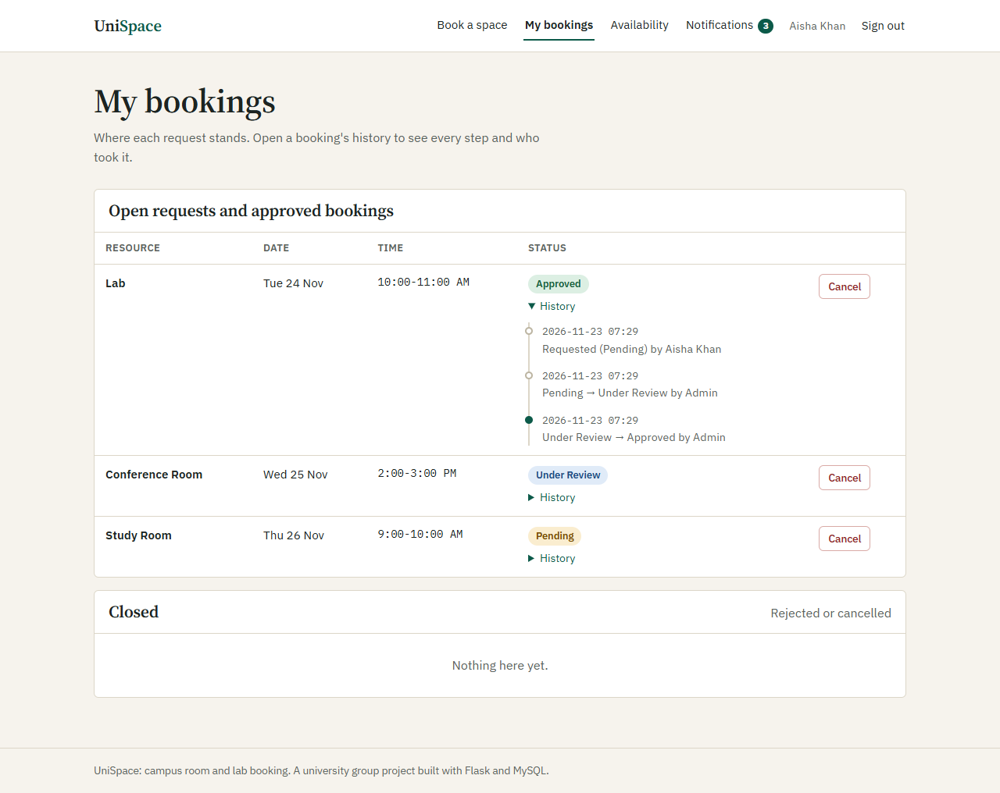 |

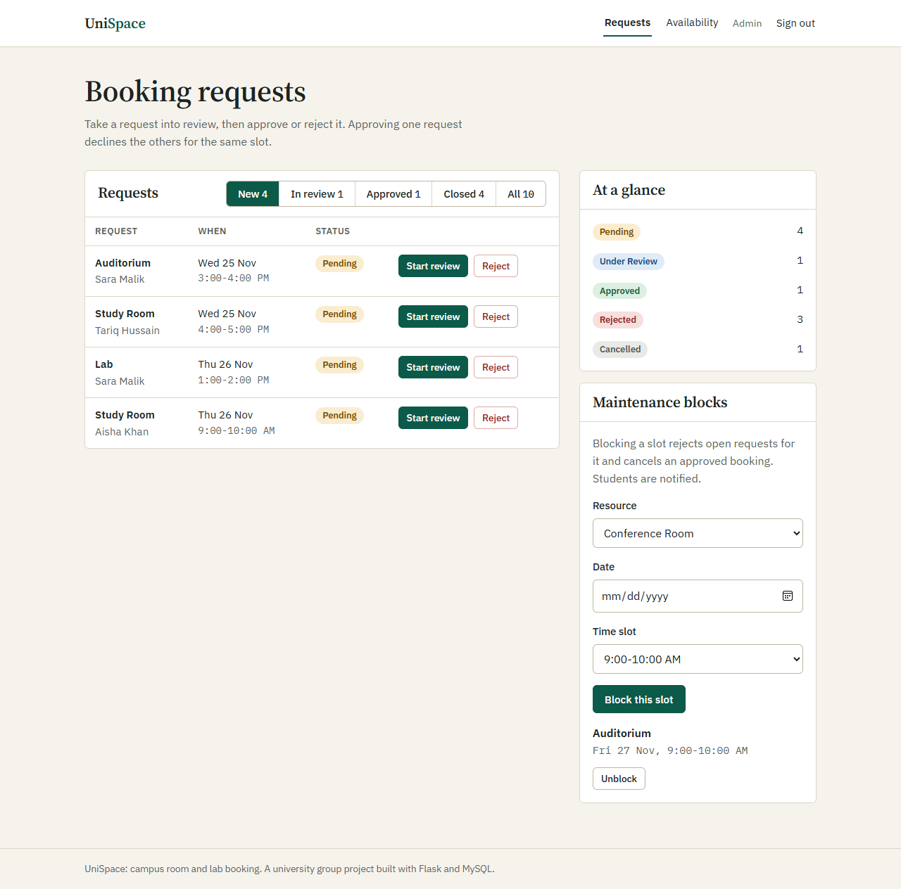

| Rejecting needs a reason | Notifications |
|---|---|
| 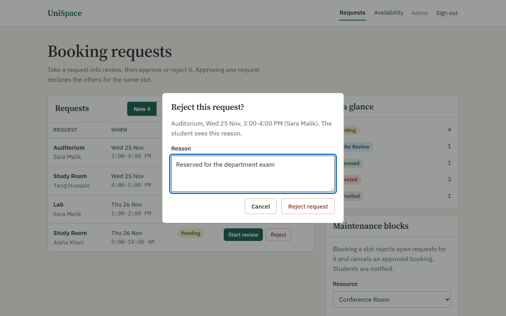 | 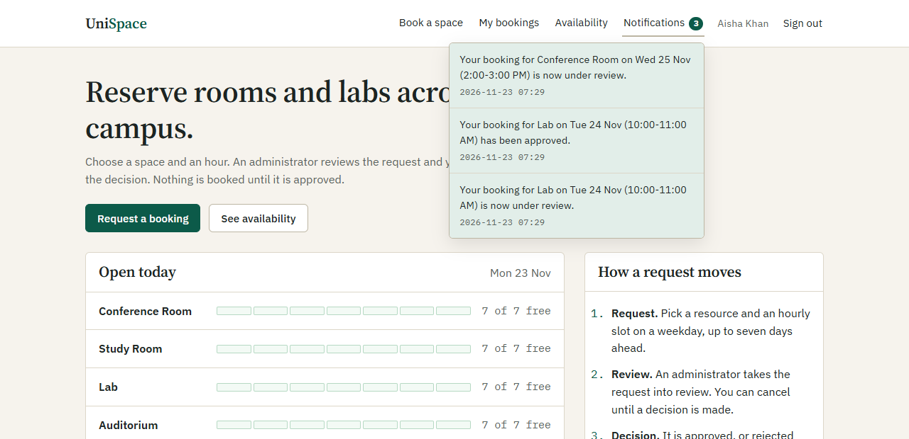 |

The layout adapts to phones; tables become stacked cards.

| Availability | Requests |
|---|---|
| 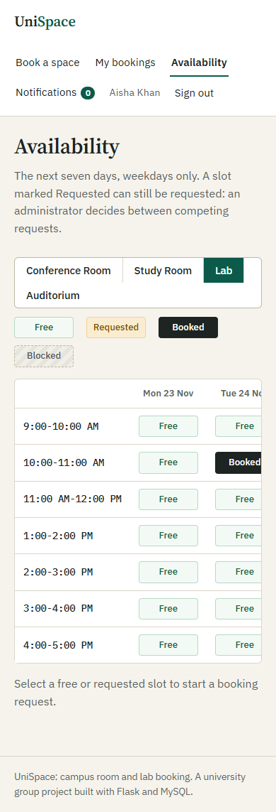 | 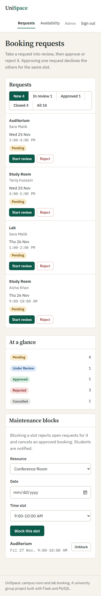 |

## The booking workflow

A request is not simply "approved or rejected". It moves through steps, with rules about who may take each one:

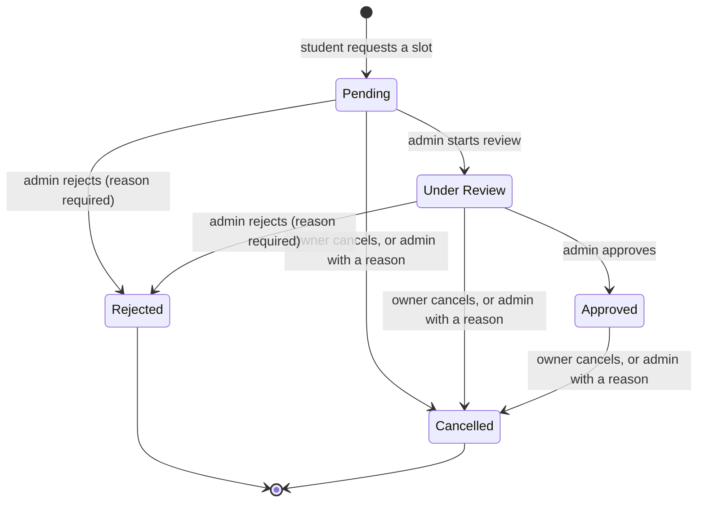

- A booking **cannot be approved before it has been taken into review**.
- **Approving** a booking automatically rejects the other open requests for the same slot and notifies those students.
- A **maintenance block** rejects open requests for that slot and cancels an approved booking.
- **Rejected and Cancelled are final.** A student whose slot was cancelled can request it again as a new booking.
- Every change is stored in `booking_events` (who, when, from, to, reason), so nothing happens silently.
- The rules live in one readable table in [`backend/workflow.py`](backend/workflow.py) and are covered by tests.

## Architecture and data model

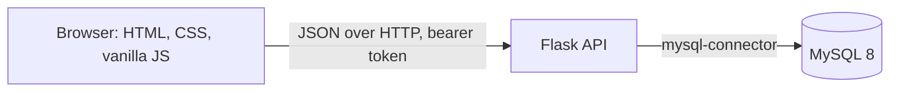

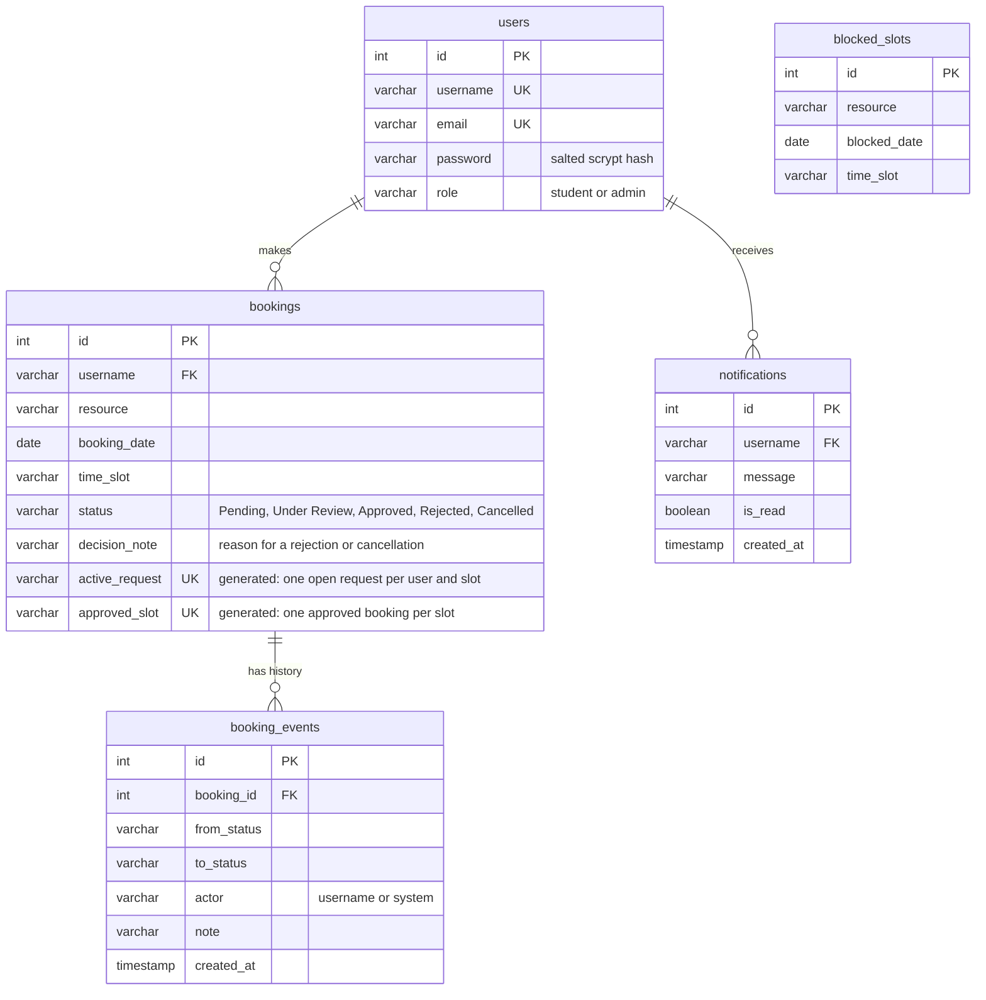

Two generated, unique columns on `bookings` turn business rules into database constraints: a user cannot hold two open requests for the same slot, and a slot can have at most one approved booking. There is a test that tries to break the second rule directly in SQL and checks that the database refuses.

## Security: what was fixed

The original submission worked but was not safe to expose. These were found by reading the code and fixed on this fork, each in its own commit:

| Before | Now |
|---|---|
| Passwords stored in plain text | Salted scrypt hashes; any legacy plain-text row is upgraded at the user's next sign-in |
| "Logged in" and "admin" were values in `localStorage` that anyone could edit | Signed, expiring login tokens. The role is read from the database on every request |
| Every admin endpoint was open to anyone | Admin-only routes answer 401 (not signed in) or 403 (wrong role) |
| A booking could be created for any username | The booking owner comes from the token, never from the request body |
| Everyone's bookings and notifications were readable | Students see only their own. The public availability endpoint returns no usernames |
| MySQL root password hardcoded in 10 places | Settings come from environment variables (`.env`, git-ignored) |
| Flask `debug=True` | Off by default; the dev server binds to 127.0.0.1 |
| CORS open to every site | Only the configured frontend origins |
| Stored XSS: a username like `` ran in the admin's browser | Output escaping everywhere, plus username rules; verified in a browser |
| No input validation, raw database errors sent to the client | Validated on the server; failures return clear messages or a generic error |
| Duplicate emails, double bookings and two approvals for one slot were possible | Unique constraints, foreign keys and generated-column rules in MySQL |

**Not done, and worth knowing about:**

- The login token is kept in `localStorage`, so a future XSS bug would expose it (cookies with `HttpOnly` would be the alternative).
- No rate limiting or lockout on sign-in.
- Plain HTTP and Flask's development server: put it behind HTTPS and a production server (waitress or gunicorn) before real use.
- No password reset, email verification or admin-management screen; administrators are created with `backend/seed_admin.py`.
- Time rules ("slot already started") use the server's local clock.

## API

Base URL `http://127.0.0.1:5000`. "Auth" means `Authorization: Bearer <token>` from `POST /signin`.

| Method and route | Who | Purpose |
|---|---|---|
| `POST /signup` | anyone | Create a student account |
| `POST /signin` | anyone | Returns `{token, username, role}` |
| `GET /meta` | anyone | Resources and time slots (single source of truth for the UI) |
| `GET /availability?resource=&from=&to=` | anyone | Which slots are requested or booked, without usernames |
| `GET /blocked_slots` | anyone | Maintenance blocks |
| `GET /me` | signed in | Current username and role |
| `POST /bookings` | student | Request a slot |
| `GET /bookings` | signed in | Own bookings (student) or all (admin) |
| `GET /bookings/<id>` | owner or admin | One booking with its history |
| `PUT /bookings/<id>/status` | owner or admin | Move through the workflow: `{status, note}` |
| `GET /notifications`, `PUT /notifications/read` | signed in | Own notifications |
| `POST /blocked_slots`, `DELETE /blocked_slots/<id>` | admin | Block or unblock a slot |

## Setup

Tested with **Python 3.15** and **MySQL 8.0.46** on Windows 11 (MySQL 8.0.16 or later is needed for the CHECK constraints and generated columns).

```bash
git clone https://github.com/abdullahwaheed0112/UniSpace.git
cd UniSpace
python -m venv .venv
# Windows: .venv\Scripts\activate      macOS/Linux: source .venv/bin/activate
pip install -r requirements.txt

cp .env.example .env        # then edit .env: database password and a SECRET_KEY
mysql -u root -p < database/schema.sql
cd backend
python seed_admin.py        # asks for the admin email and password (it hashes the password)
python app.py               # API on http://127.0.0.1:5000
```

In a second terminal, serve the frontend from the repository root and open it:

```bash
python -m http.server 5500 --bind 127.0.0.1
# then browse to http://127.0.0.1:5500/frontend/index.html
```

(VS Code Live Server also works. The allowed origins are set by `CORS_ORIGINS` in `.env`.)

**If port 5000 is already used on your machine,** start the API with `FLASK_PORT=5001` and tell the browser once, in its console: `localStorage.setItem("unispace_api_base", "http://127.0.0.1:5001")`.

**Try it with demo data** (local only; creates demo accounts that share a documented password):

```bash
cd backend && python seed_demo.py --reset
# creates admin@unispace.test and four students (aisha@example.com, bilal@..., sara@..., tariq@...)
# password for all of them: demo-password-1
```
`--reset` empties bookings, history, notifications and blocks first (accounts are kept). Never run this against a real deployment.

**Upgrading an existing database** from the original schema: apply `database/migrations/001` to `003` in order.

### Tests

```bash
pip install -r requirements-dev.txt
pytest
```

94 tests: unit tests for hashing, tokens, input rules and the workflow table, and API tests for accounts, the permission matrix, validation, the full approval workflow, competitor rejection, maintenance blocks and notifications. They run against a throwaway `unispace_test` database that the suite creates and drops itself, never your real data, and are skipped if MySQL is unreachable.

## Project structure

```text
UniSpace/
├── backend/
│   ├── app.py            # Flask routes
│   ├── auth.py           # password hashing, tokens, permission decorators
│   ├── workflow.py       # the approval workflow rules
│   ├── validators.py     # input rules, resource and slot lists
│   ├── config.py, db.py  # settings from the environment, MySQL connection
│   ├── seed_admin.py     # create the first admin
│   └── seed_demo.py      # demo data for local use
├── database/
│   ├── schema.sql
│   └── migrations/       # 001 hashing, 002 constraints, 003 workflow
├── frontend/             # HTML pages, styles.css and vanilla JS (no framework, no build step)
├── tests/                # pytest suite
├── docs/images/          # screenshots used above
├── images/               # background photo from the original design (no longer used)
├── requirements.txt, requirements-dev.txt, .env.example
└── README.md
```

## Tech stack

Python · Flask · Flask-CORS · MySQL 8 · mysql-connector-python · Werkzeug (scrypt) · itsdangerous (signed tokens) · pytest · HTML, CSS and vanilla JavaScript.

## Limitations and next steps

The security gaps still open are listed under [Security](#security-what-was-fixed). Beyond those:

- Not deployed: it has been run and tested locally only, and there is no live demo yet.
- Bookings are limited to weekdays, up to seven days ahead.
- Tests cover the Python backend; the frontend was checked by hand in a browser.
- Next: `HttpOnly` cookie sessions, sign-in rate limiting, a production server behind HTTPS, password reset, and a hosted demo.

## Group project and my part

UniSpace began as a **university group project** by three students (IDs i242582, i242510 and i242567). This repository is a fork of [`Fireguy1/UniSpace-`](https://github.com/Fireguy1/UniSpace-), the repository of that original submission. The original code is kept in the history as the first commit (`full project`).

In the original submission, **Abdullah Waheed (i242510) worked across the stack, from the Flask backend to the frontend**. The other two members' contributions are theirs to describe.

Everything after that first commit is **post-submission work by Abdullah Waheed (i242510)** and is listed in the commit history, commit by commit: the security fixes above, the approval workflow and audit trail, the database constraints, the automated tests, the redesigned frontend and this documentation.

License: none chosen yet. Contact: [GitHub](https://github.com/abdullahwaheed0112) · [LinkedIn](https://linkedin.com/in/abdullah-waheed-05a5a1416)
